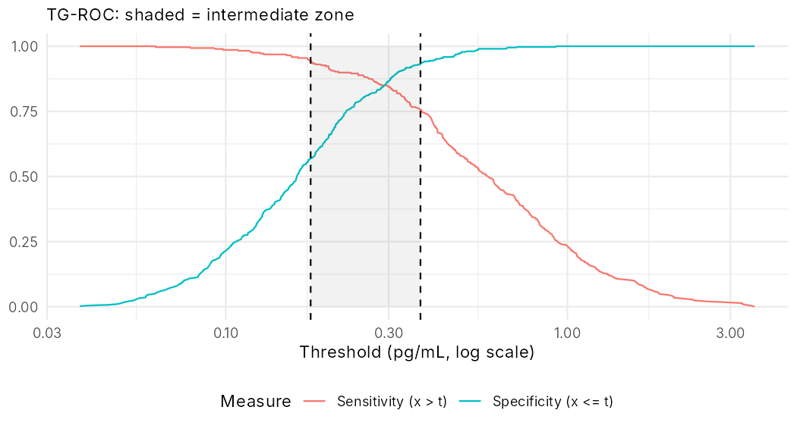

# Diagnostic and biomarker statistics in R

[](https://github.com/Ngarciar24/diagnostic-biomarker-statistics/actions/workflows/build.yml)

A Quarto book that works through the statistics of an in-vitro diagnostic or biomarker, from analytical validation to clinical performance, cut-offs, prognostic models, real-world evidence and the statistical analysis plan. Each chapter simulates a study, runs the standard analysis in R and cross-checks it independently. A hand implementation is compared with a package, or a formula with a simulation, and the book stops rendering if a check fails.

**Read it online:** <https://ngarciar24.github.io/diagnostic-biomarker-statistics/>

All data are simulated. The only real figures are public numbers from an FDA 510(k) decision summary (a plasma pTau217 test), used as a worked example and cited.

## What it covers

| Chapter | Analysis | Methods and tools |
|---|---|---|
| 1 | Regulatory landscape | IVDR, MDCG 2022-2, ISO 20916, FDA pathways |
| 2 | Precision (EP05/EP15) | ANOVA, REML and Bayesian variance components (VCA, lme4, brms); Satterthwaite df |
| 3 | Detection capability, linearity (EP17/EP06) | parametric and rank-based LoB/LoD, probit LoD with coverage check, bootstrap CI, LoQ from a precision profile |
| 4 | Method comparison, interference, stability, lots | Deming and Passing–Bablok (mcr, checked against hand code), Bland–Altman, shelf life from a one-sided bound |
| 5 | Diagnostic accuracy and ROC | Wilson and exact CIs, PPA/NPA vs sensitivity/specificity, discrepant resolution, Begg–Greenes verification-bias correction, DeLong and partial AUC |
| 6 | Cut-offs and the intermediate zone | two-cut-off derivation, lock-then-validate, prevalence and kidney-function effects; reproduces the FDA decision summary's intervals |
| 7 | Sample size and power | precision- and goal-based designs (exact binomial, assurance), AUC (Hanley–McNeil vs simulation), precision-study df |
| 8 | Companion diagnostics and bridging | CTA/CDx concordance, missing bridging samples (complete case, IPW, multiple imputation), delta-adjusted tipping point, enrichment vs all-comers power |
| 9 | Statistical analysis plan | full mock SAP with table shells filled on simulated data, double programming, audit hashes |
| 10 | Reference intervals and longitudinal markers | nonparametric RI with CIs, indirect RI (refineR), reference change value, MMRM under dropout |
| 11 | Combining markers | logistic model, bootstrap optimism (checked against `rms::validate`), external validation, calibration, decision curve |
| 12 | Time-to-event and confounding | Kaplan–Meier and Cox (partial likelihood maximised by hand), PH diagnostics, IPCW time-dependent AUC (checked against `timeROC`), propensity-score weighting, balance, E-value |

## Results

**A published result, reproduced.** Chapter 6 rebuilds the pivotal 3×2 table of the [FDA 510(k) decision summary K261686](https://www.accessdata.fda.gov/cdrh_docs/reviews/K261686.pdf) (plasma pTau217 vs amyloid PET, N = 958) and recomputes its agreement statistics. The build stops if any value differs from the published one.

| Measure (intermediates count as disagreement) | FDA K261686, % (95% CI) | Reproduced, Wilson |
|---|---|---|
| Positive percent agreement (285/378) | 75.4 (70.8-79.5) | 75.4 (70.8-79.5) |
| Negative percent agreement (424/580) | 73.1 (69.4-76.6) | 73.1 (69.4-76.6) |

**Two cut-offs and the intermediate zone** (Chapter 6, simulated derivation cohort): the rule-out cut-off holds sensitivity at 94% or more, the rule-in cut-off holds specificity at 93% or more, and results in between are reported as intermediate.



## Checks and reproducibility

- **R unit tests** (`tests/testthat/`) cover every helper in `R/`: interval methods, EP05 ANOVA, EP17 estimators, Deming/Passing–Bablok, DeLong, cut-off derivation, sample-size functions and the bridging simulation.
- **Cross-checks inside the book.** Each chapter compares results across independent routes, for example hand ANOVA vs `VCA` vs REML, or hand IPCW AUC vs `timeROC`, and stops on disagreement.
- **Python and SQL re-derivation** (`python/check_sap.py`):
  - loads the mock study into SQLite;
  - runs 14 data-management edit checks (duplicates, ranges, codelists, consistency of derived groups);
  - derives the SAP endpoints in SQL;
  - requires agreement with the R results to 1e-10.
- **Pinned environment.** `renv.lock` pins R 4.6.2 and every package.
- **CI.** GitHub Actions runs the tests, re-renders the whole book from scratch, runs the Python checks and publishes the site on every push to `main`.

```
$ python3 python/check_sap.py
Edit checks on 1100 records: 14/14 pass
  ppv_positive            303/337   89.9% (86.2-92.7)
  npv_negative            462/488   94.7% (92.3-96.3)
  ppa_incl                303/406   74.6% (70.2-78.6)
  npa_incl                462/640   72.2% (68.6-75.5)
  intermediate_fraction   221/1046  21.1% (18.8-23.7)
R vs Python/SQL: 25/25 values agree (tolerance 1e-10)
```

## Run it

```r
renv::restore()                                    # R 4.6, packages from renv.lock (limma from Bioconductor)
```

```sh
Rscript run_all.R                                  # R tests, render the book, Python/SQL checks; stops on the first failure
```

The steps can also run one by one: `testthat::test_dir("tests/testthat")`, `quarto render`, `python3 python/check_sap.py` (standard library only) and `python3 -m pytest python`. `Rscript mock_sap/simulate_study.R` regenerates the mock study data and is only needed if the simulation changes.

Requires Quarto ≥ 1.6 and R ≥ 4.6. On Linux, `epiR` needs the udunits2, GDAL, GEOS and PROJ system libraries (see the CI workflow).

## Layout

```
run_all.R                   one command: tests, book, Python checks
index.qmd, chapters/        the book (12 chapters)
mock_sap/                   SAP template, filled mock SAP, simulation script and data, note on SAPs in a regulated R environment
R/                          helper functions used by the chapters
tests/testthat/             unit tests of the helpers
python/                     SQL edit checks and cross-language re-derivation of the SAP endpoints, with pytest tests
outputs/                    endpoints exported by the SAP; outputs/qc/ holds the edit-check and cross-check reports; outputs/figures/ the README figure
claims_ledger.csv           every sourced claim with its source, date checked and confidence
question_map.csv            task → governing document → R tools
cache/                      posterior draws of the one Stan model, so the book renders without compiling Stan
```

## Sources and limits

- **Conventions.** Claims are tagged **[S]** (primary public source, listed per chapter), **[Y]** (synthesis of standard theory) or **[A]** (simulation assumption).
- **CLSI documents are paywalled.** Nothing here quotes them, and design counts that could not be checked are marked *not verified*.
- **Regulatory sources.** Facts about the IVDR, FDA guidance and the FDA decision summary were checked against the public documents on the dates in `claims_ledger.csv`.
- **Scope.** This is teaching and portfolio material on simulated data, not a validated analysis or a regulatory template.

## Related

[adam-admiral-walkthrough](https://github.com/Ngarciar24/adam-admiral-walkthrough) builds CDISC ADaM datasets, define.xml and the primary efficacy analysis for the public CDISC pilot study in R ({admiral}), with an independent Python cross-check.

## Licence

MIT. See [LICENSE](LICENSE).
